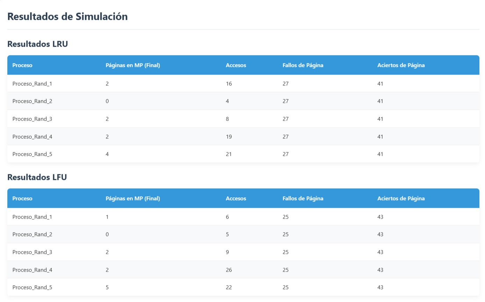

# Simulador de paginación (memoria virtual)

Proyecto de Sistemas Operativos (junio 2025). Simula cómo un sistema operativo reparte las páginas de varios procesos entre la RAM (marcos) y el swap, y compara dos políticas de reemplazo: **LRU** y **LFU**.



## Contenido
| Carpeta | Qué hay |
|---|---|
| [`java/`](java) | Versión de escritorio en Java Swing (RAM, swap, procesos y reemplazo LRU) |
| [`web/`](web) | Versión web con configuración del sistema, gestión de procesos y comparación LRU vs LFU, más un `Dockerfile` para servirla con nginx |
| [`docs/`](docs) | Informe teórico: paginación, MMU, TLB, fallos de página y políticas de reemplazo |

## Cómo ejecutarlo
**Java**
```bash
cd java
javac VirtualMemorySimulator.java
java VirtualMemorySimulator
```

**Web con Docker**
```bash
cd web
docker build -t simulador-paginacion .
docker run -p 8080:80 simulador-paginacion
```
Después abre http://localhost:8080. También puedes abrir `web/index.html` directamente en el navegador.
